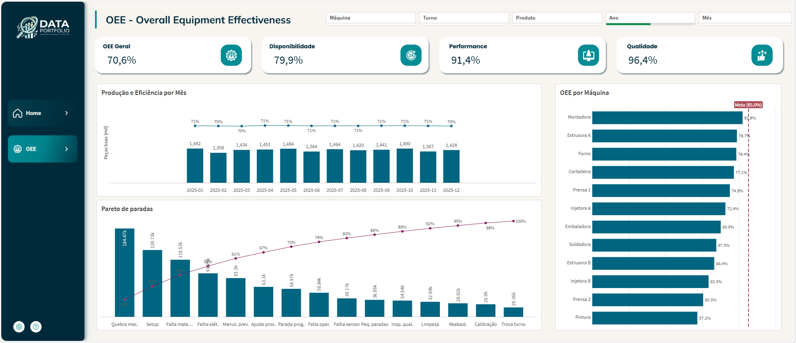
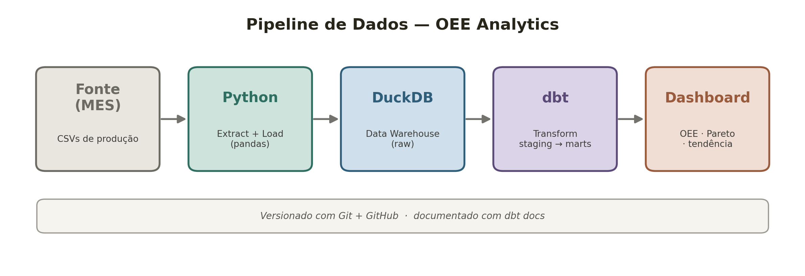
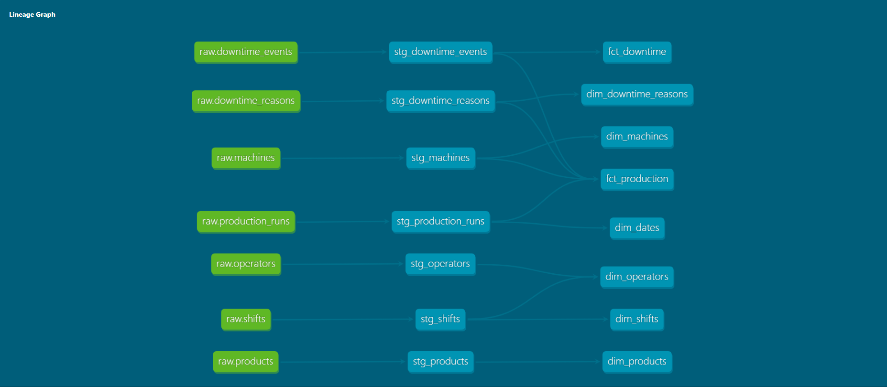

# OEE Analytics — Industrial Data Pipeline


**A plant running at 70.6% OEE — and two machines dragging the average down.** This pipeline takes a raw MES export and turns it into a number a plant manager can act on: which machine to fix first, and which stoppage reason is eating the most time.

Built with **Python + DuckDB + dbt + Qlik Sense**, with dimensional modeling and automated data quality tests.



## The questions it answers

- What is the OEE of each machine, and of the plant as a whole?
- Which stoppage reasons concentrate most of the lost time (Pareto)?
- How does efficiency vary across machines, shifts and over time?

OEE — Overall Equipment Effectiveness — is the core efficiency indicator in manufacturing: **Availability × Performance × Quality**.

## What the data showed

- **Plant OEE: 70.6%** — Availability 79.9%, Performance 91.4%, Quality 96.4%. Inside the typical industry range (world class is 85%).
- **Bottlenecks:** *Pintura* (**57.2%**) and *Prensa 2* (**60.3%**) run well below average, and weak on all three components — clear priorities for continuous improvement.
- **Top stoppage reasons:** mechanical breakdown, setup and material shortage account for most of the lost time — the first three reasons alone carry over half of it.

## Dataset

The project simulates an MES export: **18 months** of operation, **12 machines** across 3 production lines, ~**15.8k** production runs and ~**84k** downtime events. Data is synthetic — the modeling, testing and metric logic are not.

## Architecture



| Layer | Tool | Responsibility |
| --- | --- | --- |
| Ingestion | Python (pandas) | Generates and loads the raw data |
| Data warehouse | DuckDB | Stores the raw, staging and marts layers |
| Transformation | dbt | Dimensional modeling, tests and docs |
| Visualization | Qlik Sense | Interactive OEE dashboard |

## Data model (star schema)

**Facts**
- `fct_production` — grain: one production run. Holds the three OEE components.
- `fct_downtime` — grain: one downtime event.

**Dimensions**
- `dim_machines`, `dim_products`, `dim_operators`, `dim_shifts`, `dim_dates`, `dim_downtime_reasons`

Model integrity is enforced by **24 automated dbt tests**: unique keys, referential integrity between facts and dimensions, and domain validation. The build fails if any of them fails — the dashboard never reads a number the tests haven't cleared.

### Lineage

The dependency graph generated by dbt, from the `raw` sources through to the marts:



## Dashboard

Built in Qlik Sense on top of the marts exported from dbt/DuckDB. It covers:

- **KPIs** for OEE and its three components
- **OEE by machine**, against the world-class target line (85%)
- **Downtime Pareto**, highlighting the reasons that concentrate most lost time
- **Output and efficiency over time** (volume produced vs monthly OEE)
- **Interactive filters** by machine, shift, product and period

## Running it

Requirements: Python 3.11+

```bash
pip install -r requirements.txt
python ingestion/generate_data.py     # generate the raw CSVs
python ingestion/load_to_duckdb.py    # load into DuckDB (raw layer)
cd dbt_oee
dbt build                             # staging + marts + 24 tests
dbt docs generate && dbt docs serve   # documentation and lineage
cd ..
python ingestion/export_for_bi.py     # export the marts as CSV for BI
```

### dbt profile

dbt connects to the warehouse through `~/.dbt/profiles.yml`, kept outside the repository by convention:

```yaml
oee:
  target: dev
  outputs:
    dev:
      type: duckdb
      path: /absolute/path/to/warehouse/oee.duckdb
      threads: 4
```

## Project structure

```
.
├── ingestion/          # generation, load and export scripts (Python)
├── data/raw/           # raw CSVs (generated, not tracked)
├── warehouse/          # DuckDB data warehouse (generated, not tracked)
├── dbt_oee/            # dbt project (staging + marts)
├── qlik/               # Qlik Sense load script
└── docs/               # documentation and images
```

## Stack

Python · pandas · DuckDB · dbt · SQL · Qlik Sense · Dimensional modeling · Git

---

**Thiago Vinicius** — Data & BI Analyst
[LinkedIn](https://www.linkedin.com/in/thiagovinicius1)
